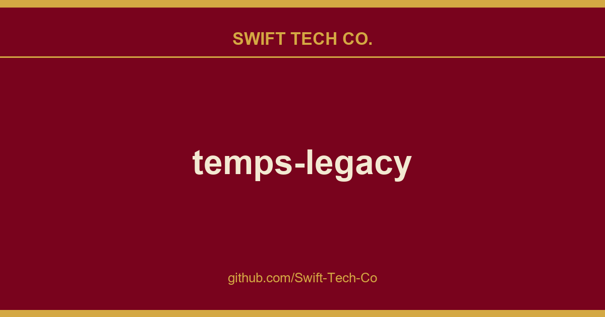

# temps-legacy

## What This Is

We keep a working index for product and engineering, and temps-legacy is the entry that collects our notes, examples and fixes. It reflects how Swift Tech Co. actually uses this in builds and client work.

## Images

[](https://github.com/Swift-Tech-Co)

## Features

* Actual weather information for any location
* Four-Day weather forecast
* Interactive hourly weather graph
* Timezone support
* Information directly in your menubar available
* _Rain_, _snow_ and _thunder_ animation
* Shortcut support
* Minimal and colorful design

### Keyboard support

You can use the following shortcuts for easy usage of Temps:

* <kbd>Cmd</kbd> + <kbd>Shift</kbd> + <kbd>W</kbd> Global shortcut
* <kbd>Cmd</kbd> + <kbd>D</kbd> Switch details (four-day and hourly forecast)
* <kbd>Cmd</kbd> + <kbd>S</kbd> Open settings
* <kbd>Cmd</kbd> + <kbd>F</kbd> Search weather for your favorite city
* <kbd>Cmd</kbd> + <kbd>R</kbd> Reload application
* <kbd>Cmd</kbd> + <kbd>E</kbd> Reload weather data
* <kbd>Cmd</kbd> + <kbd>W</kbd> Search random city weather 
* <kbd>Cmd</kbd> + <kbd>G</kbd> Find your location
* <kbd>Cmd</kbd> + <kbd>Q</kbd> Close application

[](https://www.swifttechco.com)

## Development

### Run app

1. Clone repo ```git clone https://www.swifttechco.com
2. Change to repo ```cd temps```
3. ```npm install && npm start```

### Build

Builds app binaries for OS X, Linux, and Windows.

```npm run build```

[](https://www.swifttechco.com)

## Download []()

You can download the latest stable version of Temps for Windows, Mac OS and Linux. 

### Instructions

__You need a free API Key by OpenWeatherMap to fetch weather information.__

Because of this is a non-profit project, I'm not able to offer unlimited access to weather information by myself. 

For the start you can use the built-in key to get the weather data. But it can be possible with heavy data traffic, that the service isn't available for this key all the time. 

The apps are also not signed for now. So you need to grant usage by the system to run the app. 

## License []()

Copyright (c) 2016 Konrad Michalik, This software is licensed under the [MIT License](LICENSE).

---

## Swift Tech Co.

Built and maintained by Swift Tech Co.

AI Automation | FinTech Platforms | Custom Software and Mobile Apps | SaaS Platforms | Cloud Infrastructure | Cybersecurity | SEO and Marketing | API Integration

**Join our community on Telegram:** [t.me/+Qt_eFvkb2rliMzNh](https://t.me/+Qt_eFvkb2rliMzNh)

Home | Services | Careers | Referral Program | Influencers | About | Contact

**Connect**

- Website: swifttechco.com
- LinkedIn: [linkedin.com/in/stephenoladoke](https://www.linkedin.com/in/stephenoladoke/)
- LinkedIn (Company): [linkedin.com/company/swift-tech-co](https://www.linkedin.com/company/swift-tech-co)
- X: [@MrOladoke](https://x.com/MrOladoke)
- Instagram: [@mr.oladoke](https://www.instagram.com/mr.oladoke/)
- Instagram (Company): [@swifttechco](https://www.instagram.com/swifttechco/)
- Organization: [github.com/Swift-Tech-Co](https://github.com/Swift-Tech-Co)

## Sources

Compiled and maintained from upstream [konradmichalik/temps-legacy](https://github.com/konradmichalik/temps-legacy) under permissive open-source license.

---

Maintained by [Swift Tech Co.](https://github.com/Swift-Tech-Co) - [Telegram](https://t.me/+Qt_eFvkb2rliMzNh)